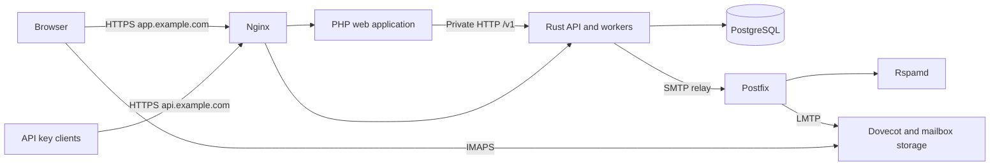

# Mailvora backend

The Rust control plane (Axum, SQLx, PostgreSQL): the REST API (`/v1`), background workers, database migrations, and the mail tier configuration for Postfix, Dovecot and Rspamd. The service never implements SMTP or IMAP itself.



| Path | Contents |
|---|---|
| `src/` | API (`api/`), authentication (`auth/`), mail building and bounces (`mail/`), services, workers |
| `migrations/` | SQL migrations, applied at start-up |
| `tests/` | Integration tests against a real PostgreSQL |
| `infra/` | Postfix, Dovecot, Rspamd, Postgres init, Nginx site, operational scripts |
| `scripts/` | Windows launchers used by the `*.cmd` files |

## Commands

```text
mailvora serve                 API + background workers (default)
mailvora api | worker          API only, or workers only
mailvora migrate               apply database migrations and exit
mailvora promote-admin EMAIL   grant platform-operator rights to a user
mailvora gen-key               print a new DATA_ENCRYPTION_KEY
mailvora healthcheck           exit 0 if the local API answers /healthz
```

## Documentation

See the [wiki](../frontend/resources/wiki/Home.md), in particular [Quick start](../frontend/resources/wiki/Quick-Start.md), [Architecture](../frontend/resources/wiki/Architecture.md), [Configuration](../frontend/resources/wiki/Configuration.md), [Sending API](../frontend/resources/wiki/Sending-API.md), [VPS deployment](../frontend/resources/wiki/VPS-Deployment.md) and [Release checklist](../frontend/resources/wiki/Release-Checklist.md).
